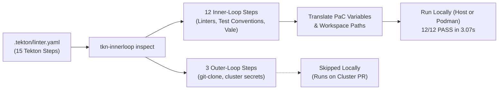

# Fast Inner-Loop Tekton Validation for Coding Agents (PoC)

Instead of re-implementing Kubernetes locally, this PoC pairs an **Agent Skill (`tekton-innerloop`)** with a lightweight CLI (`tkn-innerloop`) that inspects `.tekton/` PipelineRuns, separates fast inner-loop checks from outer-loop cluster steps, and runs the **exact** CI commands and flags against your local Git working tree in **~3 seconds**.

## Demo Recording (VHS)

- **Watch Video (MP4 Player)**: <https://share.chmouel.com/play/pipelines-as-code/tkn-innerloop-demo.mp4>
- **Animated GIF**: <https://share.chmouel.com/poub/pipelines-as-code/tkn-innerloop-demo.gif>
- **Agent Skill (`SKILL.md`)**: <https://share.chmouel.com/md/pipelines-as-code/SKILL.md>

## How It Maps to the Meeting Discussion

1. **Solve the 80% Inner-Loop Slice Without Running Kubernetes Locally**
   - Running a full control plane / virtual cluster locally is heavy when coding agents just need to know whether their code will break CI.
   - `tkn-innerloop inspect .tekton/linter.yaml` classifies **12 out of 15 steps (80%)** in Pipelines-as-Code's real `.tekton/linter.yaml` as runnable in the local inner loop (`codespell`, `shellcheck`, `commit-validation`, `check-e2e-tests-naming`, `check-test-conventions`, `yamllint`, `ruff-lint`, `ruff-format`, `markdownlint`, `vale`, `goreleaser-check`, `generate-release-yaml`) and skips cluster-only steps (`fetch-repo` StepAction, root `/usr/bin` OpenAPI schema installer, and `zizmor` requiring `HUB_TOKEN`).

2. **Exact CI Flags & Custom Pipeline Scripts vs Generic Agent Guesses**
   - In the demo, the agent writes a new Go unit test (`TestInnerLoop_ConfigValidation`) that uses `t.Errorf(...)` and has a comment typo (`teh`).
   - Running `go test ./pkg/params` **passes** in 11ms — a standard coding agent would commit and push, only to fail 4 minutes later on the cluster.
   - Running `tkn-innerloop run .tekton/linter.yaml` executes the exact `check-test-conventions` and `codespell` scripts from `.tekton/linter.yaml` (with PaC `{{ headers['X-Github-Event'] }}` and `{{ body.pull_request.base.sha }}` bound to the local branch), catching both failures in **1.8 seconds**.

3. **Pluggable Podman / Host Script Generation + Built-in Skill Management**
   - `tkn-innerloop generate .tekton/linter.yaml --runtime podman` outputs a ready-to-run `podman run --rm -v "$WORKSPACE:/workspace:Z"` script using the exact container images from each Tekton step (`registry.access.redhat.com/ubi9/python-312`, `docker.io/koalaman/shellcheck-alpine:stable`, `docker.io/golang:1.27`).
   - `tkn-innerloop skills show` / `tkn-innerloop skills install` ships the skill inside the CLI (like the Android CLI pattern discussed in the meeting).

Technical details & PoC files

### PoC Artifacts Location (`/home/chmouel/git/work/tkn-innerloop`)

- `/home/chmouel/git/work/tkn-innerloop/SKILL.md` (and `/home/chmouel/git/work/tkn-innerloop/skills/tekton-innerloop/SKILL.md`) — The Agent Skill instructing coding agents how to inspect, generate, and run `.tekton` inner-loop checks and honor `(run-local)` / `(skip-local)` descriptions.
- `/home/chmouel/git/work/tkn-innerloop/bin/tkn-innerloop` — CLI with `inspect`, `generate` (`--runtime host|podman|docker`), `run` (`--steps`, `--fail-fast`), and `skills` (`show|install`).
- `/home/chmouel/git/work/tkn-innerloop/demo/demo.tape` — VHS tape used to record the end-to-end execution against `/home/chmouel/git/pac/main/.tekton/linter.yaml`.
- `/home/chmouel/git/work/tkn-innerloop/demo/toggle-defects.sh` — Helper script that injects and fixes the `check-test-conventions` + `codespell` violations during the recording.

