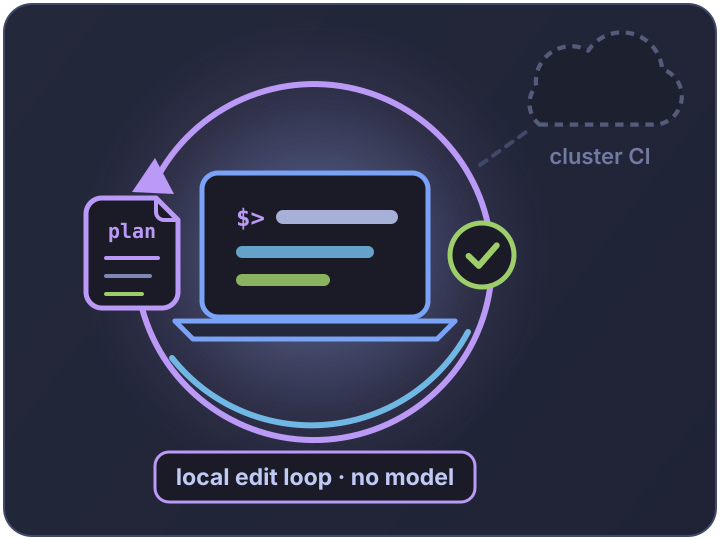
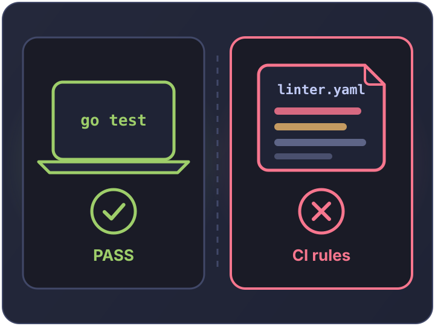
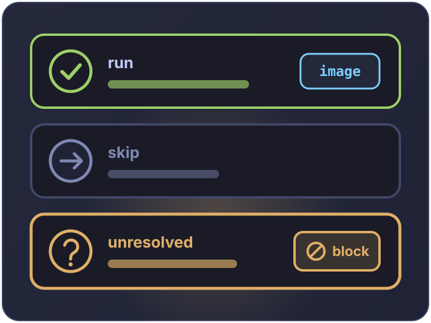
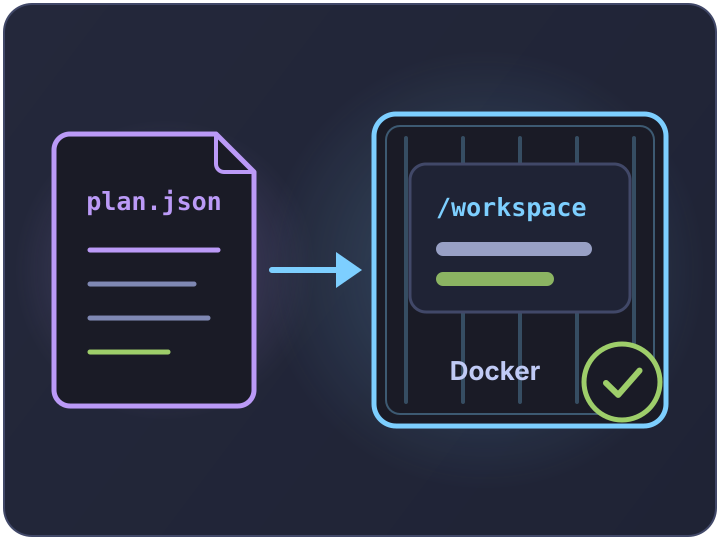
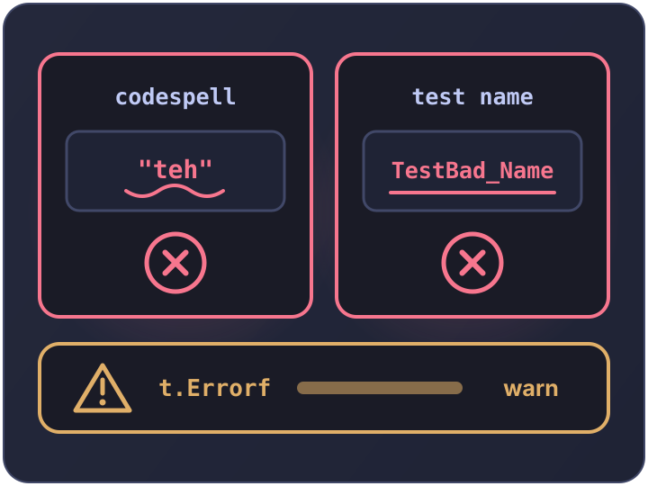
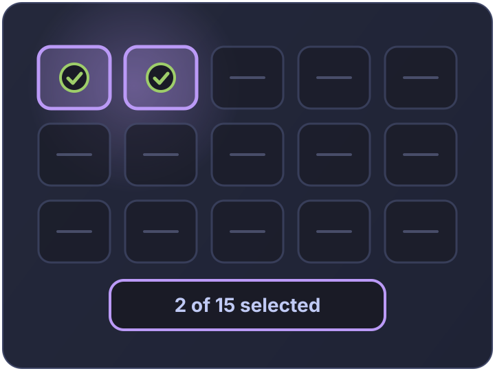
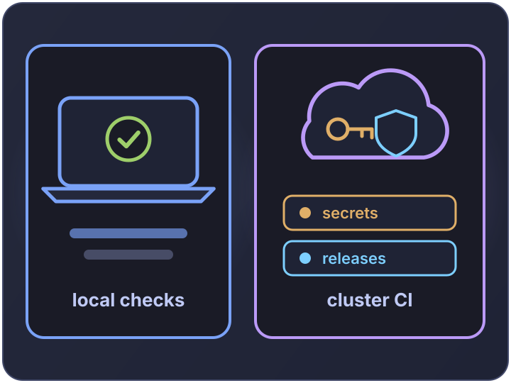

<!-- slide: layout=split flip -->
# Tekton checks in the local edit loop



An agent converts the pipeline with repository context. A saved plan runs the selected checks after each code edit.

<!-- notes:
The conversion happens once per set of pipeline inputs. The repeated edit loop uses a deterministic runner and does not call a model.
-->

<!-- slide: layout=split -->
## Generic checks miss repository rules



- `go test` can pass while the pipeline rejects a test name or a spelling mistake.
- Read the actual CI recipe, including its helper scripts and configuration.

<!-- notes:
Generic local checks run standard tools, not the repository's own scripts and flags. Reading the pipeline and its referenced helpers exposes those rules.
-->

## Convert once with repository context

```mermaid
flowchart LR
  Repo@{ img: "/icons/repository.svg", label: "YAML and helpers", w: 48, h: 48, constraint: "on" }
  Agent@{ img: "/icons/agent.svg", label: "Read and propose", w: 48, h: 48, constraint: "on" }
  Plan@{ img: "/icons/document.svg", label: "Review edits", w: 48, h: 48, constraint: "on" }
  Validate@{ img: "/icons/check.svg", label: "Validate plan", w: 48, h: 48, constraint: "on" }
  Run@{ img: "/icons/container.svg", label: "Run local scope", w: 48, h: 48, constraint: "on" }
  Repo --> Agent --> Plan --> Validate --> Run

%% play: Initial conversion
%% Repo -> Agent | The agent reads the pipeline, Makefiles and referenced scripts with read-only tools
%% Agent -> Plan : exact edits | Every source step gets a run, skip or unresolved decision
%% Plan -> Validate | Review the changes; the CLI checks hashes, provenance and syntax
%% Validate -> Run | The saved plan executes inside the declared source images
```

<!-- notes:
The agent reads the pipeline YAML, Makefiles, and helper scripts once, then writes a structured execution plan for human review.
-->

## Keep the source script visible

```diff
-files=$(git diff --name-only "${base_sha}..HEAD" -- '*.go')
+files=$({ git diff --name-only "$BASE_SHA" -- '*.go';
+          git ls-files --others --exclude-standard -- '*.go'; })
```

The plan records exact replacements and reasons. Review changes to file selection and PR context.

<!-- notes:
This slide abbreviates the file filters for readability. The execution plan preserves the full script and shows the actual unified diff with validate --diff.
-->

<!-- slide: layout=split flip -->
## Unknown requirements stay unresolved



- Every source step has a decision and a reason.
- Runnable steps retain their image and declare setup dependencies.
- Unresolved steps block their selected scope.
- Syntax and provenance checks cannot prove equivalent behavior.

<!-- notes:
There is no allowlist or blacklist by command name. If a step depends on unmodeled cluster state or unknown inputs, it stays unresolved and blocks execution when selected.
-->

<!-- slide: layout=split -->
## Run the generated artifact



- `generate` writes the scoped plan.
- `validate --diff` shows the exact script edits.
- `run` executes the selected steps in Docker.

Docker executes the scripts. Generation alone does not establish that they work.

<!-- notes:
Full commands: tkn-innerloop generate .tekton/linter.yaml --steps codespell,check-test-conventions -o /tmp/plan.json, then validate /tmp/plan.json --diff, then run /tmp/plan.json --base main. Generate writes the scoped JSON plan, validate --diff shows the exact script adaptations, and run executes the selected steps in Docker against the worktree.
-->

<!-- slide: layout=split flip bg=muted -->
## Two checks from the real PaC pipeline



- The fixture passes `go test`.
- Codespell rejects the typo; the convention check rejects the test name.
- Fix the fixture and rerun the same plan. The `t.Errorf` rule only warns.

<!-- notes:
The demo uses two real steps from Pipelines-as-Code's linter pipeline. Both fail on the injected mistakes, while the t.Errorf check prints a warning without failing the run.
-->

## Reuse the plan after code edits

```mermaid
flowchart LR
  Edit@{ img: "/icons/code.svg", label: "Edit source", w: 48, h: 48, constraint: "on" }
  Hash@{ img: "/icons/fingerprint.svg", label: "Check inputs", w: 48, h: 48, constraint: "on" }
  Run@{ img: "/icons/container.svg", label: "Run saved plan", w: 48, h: 48, constraint: "on" }
  Result@{ img: "/icons/report.svg", label: "Scoped result", w: 48, h: 48, constraint: "on" }
  Convert@{ img: "/icons/agent.svg", label: "Regenerate", w: 48, h: 48, constraint: "on" }
  Edit --> Hash
  Hash valid@-->|unchanged| Run
  Hash stale@-->|changed| Convert
  Convert --> Hash
  Run --> Result --> Edit

%% play: Code edit
%% skip Convert
%% Edit -> Hash | Pipeline and listed helper/configuration hashes remain unchanged
%% Hash -> Run @valid : no model
%% Run -> Result | Report the executed checks and skipped or unresolved scope
%% Result -> Edit
%% play: Pipeline input changed
%% skip Run Result
%% Edit -> Hash
%% Hash -> Convert @stale | A changed pipeline or listed helper invalidates the plan
%% Convert -> Hash : reviewed plan
```

<!-- notes:
During normal editing, source changes do not alter the pipeline or helper hashes, so the runner executes immediately without calling a model.
-->

<!-- slide: layout=split -->
## Report the scope and setup costs



- **2 of 15** steps selected in this demo; the other 13 stay outside its scope.
- Conversion and image pulls are setup costs.
- Reruns use cached images and still execute the setup commands in their scripts.

<!-- notes:
Every run reports what was executed and what remained outside the selected scope. Setup costs happen upfront, while script-level setup still runs inside the container.
-->

<!-- slide: layout=split flip -->
## Cluster CI still owns the rest



- **Local scope** covers the executed checks.
- **Cluster CI** still runs services, secrets, releases and other excluded requirements.
- **Moving parts** like image tags, downloads and omitted input dependencies can change behavior between runs.

<!-- notes:
Local execution complements cluster CI for fast feedback on selected checks, while cluster services, secrets, release tasks, and full pipeline verification remain in CI.
-->
